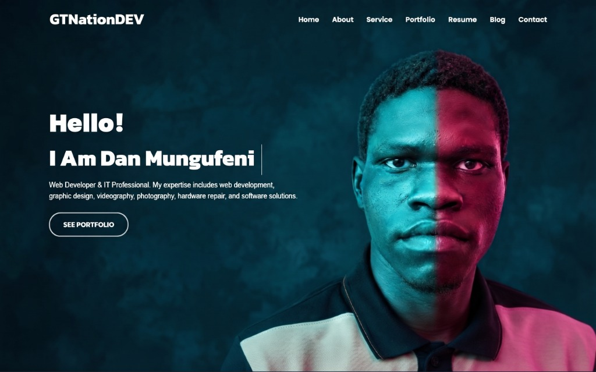

# Dan Mungufeni | GTNationDEV & AJMTechnologies

> **BUILD &bull; CREATE &bull; INNOVATE**  
> Official Portfolio, Authentication System, and Client Resource Hub for **Dan Mungufeni** ([@danmungufeni-dev](https://github.com/danmungufeni-dev)).



---

## 🌟 About Dan Mungufeni

- **Full Name**: Dan Mungufeni
- **Current Academic Standing**: Enrolled in Year 2, Semester 1 of the **Bachelor of Information Technology** at **Muni University** (*Reg. No: 2025/U/MIT/02154*).
- **Professional Roles**:
  - **Assistant IT Personnel** at **Industrial Globus Uganda Ltd**
  - **Founder & Independent Digital Service Provider** at **GTNationDEV** & **AJMTechnologies** (Web Development, Graphic Design, Video Editing, Photography, Hardware Repair, Software Solutions)
  - Former **Biometric Voter Verification Kit (BVVK) Operator** for the Electoral Commission (2026 General Elections)
  - Former **Entertainment Prefect** at Mvara Secondary School & **Speaker** for the Mvara Maracha Students Association (2022–2023)
- **Active Projects & Fellowships**:
  - **PadCare**: Flutter Mobile Application for reproductive healthcare and hygiene management
  - **Aspire Leaders Program**: Selected into Cohort 4 (founded by Harvard faculty)
  - **Competitions & Fellowships**: Huawei ICT Competition 2026/2027, Millennium Fellowship Class of 2027 applicant, Ajaboa Nyanga Chair Project 2026 Phase II committee
  - **Training & Cybersecurity**: Hack The Box Academy & DIZA Academy

---

## 📂 Project Architecture

```text
MyPortfolioSite/
├── index.html                    # Complete cinematic homepage with integrated modal
├── auth.html                     # Standalone dedicated Login/Register/Download page
├── server.ps1                    # Zero-dependency local HTTP server script
├── README.md                     # Project documentation & deployment guide
├── .gitignore                    # Standard development ignore rules
└── assets/
    ├── css/
    │   └── style.css             # Cinematic dark theme, neon lights, glassmorphism, responsive grid
    ├── js/
    │   └── main.js               # Modal controller, validation, toast notices, CV download
    ├── docs/
    │   └── Dan_Mungufeni_CV.html # Print-ready & downloadable Curriculum Vitae
    └── images/
        ├── dan-neon-portrait.jpg # Cropped cyan & magenta dual-light portrait of Dan
        ├── homepage-hero.jpg     # Original full homepage mock
        ├── hero-login.png        # Cropped hero showcase banner for Login
        ├── hero-register.png     # Cropped hero showcase banner for Register
        └── logo.png              # Monogram and wordmark brand logo
```

---

## 💻 Technical Setup & Rig

- **Primary Workstation**: 11th Gen Intel Core i5-11400 Windows PC (16 GB RAM)
- **Secondary Workstation**: HP EliteDesk 800 Tower PC
- **Mobile Diagnostics**: Samsung Android Device (used for PadCare testing)
- **Development Toolchain**: Kali Linux, GitHub Copilot, Google AI Studio, VS Code

---

## 🚀 Running Locally

```powershell
cd "C:\Users\Students\.gemini\antigravity\scratch\MyPortfolioSite"
.\server.ps1 -Port 3000
```
Then visit [http://localhost:3000/](http://localhost:3000/) in any browser.

---

## 📬 Contact & Social Channels

- **Primary Email**: [dan.mungufeni.dan@gmail.com](mailto:dan.mungufeni.dan@gmail.com)
- **Secondary Email**: [albertasuma06@gmail.com](mailto:albertasuma06@gmail.com)
- **WhatsApp / Phone**: [+256 778 625624](https://wa.me/256778625624)
- **Residence**: Arua City, Uganda
- **Live Portfolio**: [gtnationdev.vercel.app](https://gtnationdev.vercel.app)
- **X (Twitter)**: [@GTNationDEV](https://x.com/GTNationDEV)
- **Instagram**: [@gt_nationdev](https://instagram.com/gt_nationdev)
- **TikTok**: [@gtnationdev](https://tiktok.com/@gtnationdev)
- **GitHub**: [@danmungufeni-dev](https://github.com/danmungufeni-dev)

&copy; 2026 Dan Mungufeni. All rights reserved.
