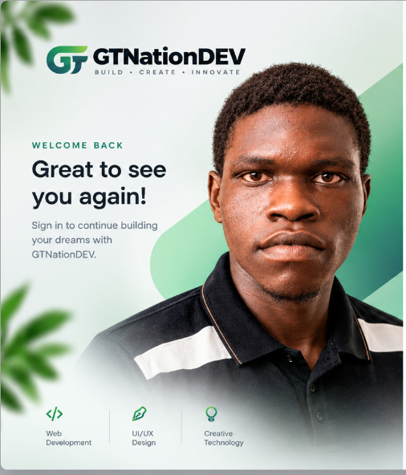

# GTNationDEV - Portfolio & Auth/Download Platform

> **BUILD &bull; CREATE &bull; INNOVATE**  
> Official Portfolio, Authentication System, and Client Resource Hub for **Dan Mungufeni** ([@danmungufeni-dev](https://github.com/danmungufeni-dev)).



---

## 🌟 Overview

This repository powers **Dan Mungufeni's** developer portfolio site and interactive client portal. Built with a focus on high aesthetic fidelity, micro-interactions, responsive design, and seamless user experience, it features:

1. **Portfolio Showcase (`index.html`)**:
   - Modern hero section introducing Dan Mungufeni (Full-Stack Web Developer, UI/UX Designer, Creative Technologist).
   - Core disciplines: Web Development, UI/UX Design, Creative Technology.
   - Live availability badge and direct CTAs to download CV or join the GTNation community.
   - Header with dynamic user session persistence (`localStorage`) and quick access pills.

2. **Pixel-Perfect Login & Register System (`auth.html` & Embedded Modal)**:
   - Faithfully modeled after the GTNationDEV design specifications.
   - Seamless instant tab switching between **Login**, **Register**, and **Download CV & Assets**.
   - Password reveal / conceal toggle with responsive SVG eye icons.
   - Form validation with custom status styling and toast notification engine.
   - Social authentication buttons for Google, GitHub, and X (Twitter).

3. **Curriculum Vitae & Asset Download Engine**:
   - Dedicated download modal / view with customizable asset packages:
     - **Dan Mungufeni Official CV / Resume**
     - **Portfolio & Case Studies Pack**
   - Simulated progress bar and automated browser download trigger for `Dan_Mungufeni_CV.html` (print-ready / PDF-ready format).
   - Lead capture fields (Name, Email, Organization) for recruiters and prospective clients.

---

## 📂 Project Structure

```text
MyPortfolioSite/
├── index.html                 # Flagship Portfolio homepage with embedded modal
├── auth.html                  # Standalone dedicated Login/Register/Download page
├── README.md                  # Project documentation & deployment guide
├── .gitignore                 # Standard git ignores
└── assets/
    ├── css/
    │   └── style.css          # Design system, CSS variables, glassmorphism, responsive grid
    ├── js/
    │   └── main.js            # Modal controls, auth simulation, form validation, download trigger
    ├── docs/
    │   └── Dan_Mungufeni_CV.html # Printable, ATS-friendly curriculum vitae
    └── images/
        ├── dan-mungufeni.jpg  # Original high-res portrait of Dan Mungufeni
        ├── hero-login.png     # Rendered visual hero artwork for Login
        ├── hero-register.png  # Rendered visual hero artwork for Register
        └── logo.png           # GTNationDEV brand logo
```

---

## 🚀 Getting Started

### 1. View Locally
Because the project is built with zero-dependency vanilla HTML5, CSS3, and modern ES6+ JavaScript, you can open it immediately:

- **Option A (Direct File)**: Double-click `index.html` or `auth.html` to open in any web browser (Chrome, Edge, Firefox, Safari).
- **Option B (VS Code Live Server)**: Right-click `index.html` in VS Code and select **Open with Live Server**.
- **Option C (Local HTTP Server via Python or npx)**:
  ```bash
  # If you have Python installed:
  python -m http.server 3000
  ```

### 2. Deep Links & Modes
You can link directly to specific modal tabs or auth modes:
- **Login**: `auth.html#login` or `index.html#login`
- **Register**: `auth.html#register` or `index.html#register`
- **Download CV**: `auth.html#download` or `index.html#download`

---

## 🌐 Deploy to GitHub Pages

To make this site live at `https://danmungufeni-dev.github.io/MyPortfolioSite/`:

1. Push this repository to GitHub:
   ```bash
   git add .
   git commit -m "Initial commit: GTNationDEV portfolio with login and CV download form"
   git branch -M main
   git push -u origin main
   ```
2. On GitHub, go to your repository **Settings** &rarr; **Pages**.
3. Under **Branch**, select `main` and `/ (root)`.
4. Click **Save**. Within a few minutes, your site will be live!

---

## 👤 Author & Contact

**Dan Mungufeni**  
- **Brand**: GTNationDEV (*BUILD • CREATE • INNOVATE*)  
- **Phone / WhatsApp**: [+256 778 625624](tel:+256778625624)  
- **GitHub**: [@danmungufeni-dev](https://github.com/danmungufeni-dev)  
- **Location**: Kampala, Uganda  

&copy; 2026 Dan Mungufeni. All rights reserved.
